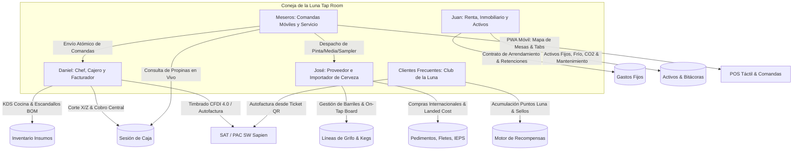
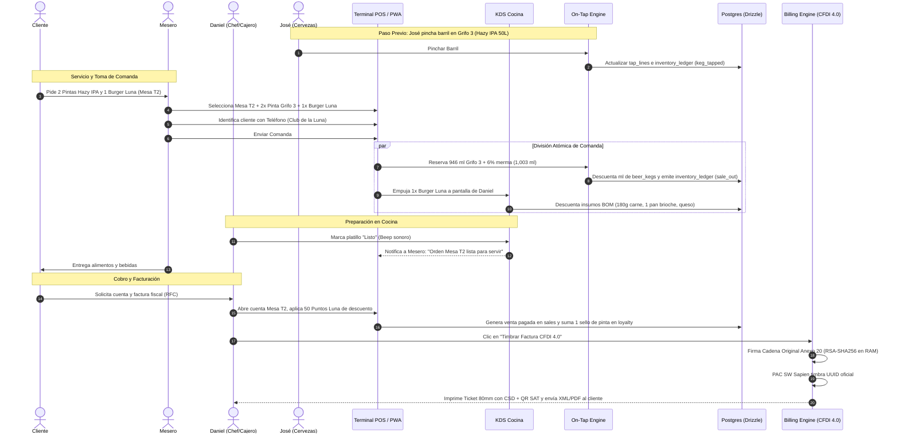

# 15 · Arquitectura del Sistema ERP-POS Tap Room — «Coneja de la Luna»

**Proyecto:** Coneja de la Luna Tap Room  
**Autor:** Exkalibur Consulting — Lead Worker (`exkalibur-lead-worker`)  
**Fecha:** 3 de Noviembre de 2026  
**Estado:** Especificación Arquitectónica Canónica  
**Base Tecnológica:** Next.js 15 App Router · React 19 · Tailwind CSS 4 · Drizzle ORM · PostgreSQL 16 · Supabase Realtime · PWA Offline · CFDI 4.0 (`exkalibur-billing-service`)

---

## 1. Resumen Ejecutivo y Visión del Negocio

**Coneja de la Luna Tap Room** es un establecimiento gastronómico y cervecero artesanal de alta especialidad que combina:
1. **Despacho de cerveza de barril (Draft Beer) y venta de botellas/latas artesanales e importadas.**
2. **Cocina de autor / Alimentos maridados** con recetas de alta rotación e insumos perecederos.
3. **Servicio dinámico a comensales** en tres ambientes: Salón principal, Barra de grifos y Terraza.
4. **Espacio físico en arrendamiento** con activos de refrigeración, CO2/gas y mobiliario de alta inversión.
5. **Programa de lealtad y cliente frecuente** para fomentar recurrencia en la comunidad cervecera local.

Para resolver de forma unificada esta operación, se diseña una solución arquitectónica que fusiona las dos mejores referencias de la industria:
- **Modelo Odoo (ERP de Inventario, BOM y Operaciones):** Libro inmutable de movimientos, listas de materiales/escandallos (Bill of Materials) para alimentos, trazabilidad por barril/lote (Keg Tracking) con control de merma por espuma, órdenes de compra internacionales con costeo de internación prorrateado (*Landed Cost* con IEPS e IVA de importación) y control de activos fijos/arrendamiento.
- **Modelo Loyverse (Punto de Venta Táctil, Caja y Comandas):** POS móvil para meseros con mapa de mesas interactivo, cuentas abiertas (*Tabs*), división de cuentas (*Split Bill*), pantalla de cocina/barra (KDS / Kitchen Display System), cortes de caja X/Z con arqueo ciego de billetes/monedas, y motor de recompensas y fidelización multicanal.
- **Facturación Electrónica Nativa (Exkalibur Billing Core):** Timbrado CFDI 4.0 directo en el punto de cobro y portal web de autofactura para clientes mediante código QR en el ticket de 80 mm.

---

## 2. Los 4 Usuarios Finales (Personas Operativas)



### 2.1 Daniel (Danel) — Chef, Cajero Principal y Operador Fiscal
- **Rol en Cocina (Chef):**
  - Pantalla táctil de cocina (KDS) con comandas entrantes divididas por tiempos (entradas, principales, postres).
  - Escandallos automáticos (BOM): cada hamburguesa o platillo despachado deduce gramos de carne, pan brioche, quesos y salsas en el almacén de cocina.
- **Rol en Caja:**
  - Apertura con fondo inicial de efectivo, retiros menores de emergencia (compra de hielo o insumos frescos urgentes).
  - Cobro centralizado de cuentas abiertas transferidas desde las mesas.
  - Arqueo ciego de cierre de turno (Corte Z) con desglose físico de monedas y billetes.
- **Rol Fiscal (Facturación):**
  - Emisión de facturas CFDI 4.0 en mostrador a partir del ticket pagado.
  - Emisión de factura global diaria/semanal de ventas al público en general.
  - Supervisión del portal de autofacturación para clientes que se retiran con su ticket.

### 2.2 José — Proveedor y Gestor de Cervezas y Bebidas Importadas
- **Rol en Grifos y Barriles (Tap Room Specialist):**
  - Pizarra digital de grifos (*On-Tap Board*): asignación de barriles a líneas 1 a 16.
  - Control de volumen fraccionario: las ventas de pintas (473 ml), medias pintas (250 ml), samplers (120 ml) o growlers (1.9 L) descuentan directamente el volumen del barril activo.
  - Calibración de merma por espuma y purga de líneas (factor técnico del 5% al 8%).
  - Alertas automáticas de barril por agotarse (< 15%).
- **Rol en Compras de Importación (Landed Cost):**
  - Registro de órdenes de compra a cervecerías internacionales en moneda extranjera (USD, EUR, GBP).
  - Pólizas de importación y pedimentos aduanales: registro de flete internacional, seguro, aranceles (IGI), DTA e impuestos especiales: **IEPS según graduación alcohólica** (26.5% si ABV ≤ 14°, 30% si ABV 14°-20°, 53% si ABV > 20°) e IVA (16%).
  - Prorrateo automático de gastos de internación al costo unitario en centavos MXN de cada barril, botella o lata para alimentar el libro mayor con costo promedio ponderado exacto.

### 2.3 Juan — Encargado de Renta, Inmobiliario y Activos Fijos
- **Rol en Inmueble y Arrendamiento:**
  - Registro del contrato de arrendamiento del local, vigencia, calendarios de pago y ajustes anuales por inflación (INPC).
  - Retenciones fiscales de arrendamiento: retención de 10% de ISR y 10.6667% de IVA cuando el arrendador es persona física.
- **Rol en Activos Fijos e Infraestructura:**
  - Inventario físico y depreciación de equipos críticos: cuarto frío (*walk-in cooler*), kegerators, torres de servicio de grifos, tanques y reguladores de CO2 / Nitrógeno cervecero (Beergas 70/30), equipo pesado de cocina de Daniel y mobiliario de salón/terraza.
  - Bitácoras de mantenimiento preventivo: limpieza química obligatoria de líneas de cerveza (quincenal con hidróxido de sodio y ácido fosfórico) y recarga de gases.
- **Rol en Finanzas Operativas:**
  - Control de gastos operativos fijos (luz CFE tarifa de alto consumo, agua, gas, nóminas, licencias municipales de alcoholes).
  - Reporte consolidado de flujo de caja y rentabilidad neta para socios.

### 2.4 Meseros (Waitstaff) — Servicio Ágil y Comandas Móviles
- **POS Móvil PWA (Tablet / Smartphone):**
  - Mapa interactivo de mesas dividido por áreas: Salón Principal, Barra de Grifos y Terraza.
  - Estado visual de mesas en tiempo real (Libre, Ocupada con cuenta abierta, Comanda en preparación, Cuenta solicitada).
  - Modificadores al vuelo: notas para Daniel en cocina ("término medio", "sin cebolla") y especificación de cristalería para el barman.
  - Cuentas abiertas (*Tabs*) por nombre de cliente.
  - División de cuentas (*Split Bill*): separación individual por productos consumidos o división equitativa del total.
  - Propinas: sugerencia en cobro (10%, 15%, 20%) y visualización transparente del pool de propinas acumuladas en su turno.
  - Resiliencia offline: si la red Wi-Fi de la terraza oscila, la PWA sigue operando en IndexedDB con sincronización idempotente sin perder comandas ni duplicar cargos.

### 2.5 Clientes Frecuentes — Sistema de Recompensas «Club de la Luna»
- Identificación instantánea en comanda o cobro mediante número de teléfono (WhatsApp) o código QR digital.
- **Mecánicas de Fidelización:**
  - **Puntos Luna:** Acumulación del 5% al 10% del total de consumo en puntos canjeables por dinero en futuros consumos.
  - **Club de la Pinta (Tarjeta de Sellos):** 1 sello por cada pinta servida; al juntar 10 sellos, la siguiente pinta artesanal de la casa es gratis.
  - **Niveles de Membresía (Tiers):** *Gazapo* (Base), *Conejo Cervecero* (Intermedio: cata gratis en cambio de barril) y *Luna Llena VIP* (Avanzado: 10% en cocina martes a jueves y acceso preferencial a lotes importados exclusivos de José).
- Portal web ligero (`/club-coneja`) para consulta de saldo y catálogo de recompensas sin necesidad de instalar apps pesadas.

---

## 3. Reutilización Estratégica del Ecosistema Exkalibur

El desarrollo de Coneja de la Luna Tap Room maximiza la inversión previa de código de Exkalibur Consulting reutilizando más del 70% de la lógica probada:

| Capacidad Requerida | Componente a Reutilizar | Fuente en el Workspace | Adaptación para Tap Room |
| --- | --- | --- | --- |
| **Sesiones de Caja & Arqueo** | `cashSessions`, `cashMovements`, cortes X/Z | `SistemaVentasRetail/src/server/db/schema/sales.ts` | Soporte para propinas en caja y retiros rápidos de caja chica de cocina. |
| **Libro Inmutable de Inventario** | `inventoryLedger` con triggers PostgreSQL inmutables | `SistemaVentasRetail/src/server/db/schema/inventory.ts` | Nuevos tipos de movimiento: `tap_shrinkage` (espuma/merma), `recipe_consumption` (cocina). |
| **Compras & Costeo Promedio** | `suppliers`, `purchaseOrders`, `landedCosts` | `SistemaVentasRetail/src/server/db/schema/purchasing.ts` | Extensión para monedas extranjeras (USD/EUR) e impuestos aduanales/IEPS para José. |
| **Clientes y Crédito** | `customers`, límites de crédito y grupos | `SistemaVentasRetail/src/server/db/schema/customers.ts` | Integración con cuenta de puntos y tarjeta de sellos del Club de la Luna. |
| **Motor de Promociones** | Motor compartido POS/servidor con cupones | `SistemaVentasRetail/src/server/db/schema/promotions.ts` | Promociones Happy Hour por horario en grifos y combos maridaje (pinta + burger). |
| **Venta Offline Idempotente** | Dexie / IndexedDB con UUIDs de cliente | `SistemaVentasRetail/src/lib/pos/sync.ts` | Comandas móviles de meseros en terraza tolerantes a desconexiones de Wi-Fi. |
| **Tickets de 80 mm** | Renderizador de tickets ESC/POS y web print | `SistemaVentasRetail/src/app/(print)/ticket` | Formato doble: comanda de barra/cocina y ticket de cobro con QR de autofacturación. |
| **Reportes y Analítica 5A** | Ventas por hora, utilidad bruta, Excel/PDF | `SistemaVentasRetail/src/server/modules/reports` | Integración del costo real de barriles y escandallos para medir margen exacto por litro y platillo. |
| **Criptografía CSD en RAM** | `CsdCryptoService` (RSA-SHA256 PKCS#1 v1.5) | `exkalibur-billing-service/src/lib/billing/crypto` | Firma de Cadena Original Anexo 20 con cero escritura en disco. |
| **Envelope Encryption CSD** | `EnvelopeEncryptionService` (AES-256-GCM) | `exkalibur-billing-service/src/lib/billing/crypto` | Custodia hiper-segura de certificados de sello digital de Coneja de la Luna. |
| **Cálculo Fiscal SAT** | `TaxCalculator` con `Decimal.js` | `exkalibur-billing-service/src/lib/billing/taxEngine` | Validación estricta CFDI40169, desglose de IVA 16% y retenciones RESICO 626. |
| **Adaptador PAC SW Sapien** | `SWSapienAdapter` con tolerancia a error 307 | `exkalibur-billing-service/src/lib/billing/pac` | Timbrado e idempotencia contra timeouts de red en horarios de alta afluencia. |

---

## 4. Arquitectura de Datos (Drizzle ORM Extensions)

Para integrar las nuevas capacidades de Tap Room, Escandallos, Importaciones, Inmobiliario, KDS y Recompensas, se diseñan las siguientes extensiones del esquema sobre PostgreSQL:

### 4.1 Módulo Tap Room & Barriles (`src/server/db/schema/taproom.ts`)

```typescript
import { sql } from "drizzle-orm";
import { pgTable, uuid, text, numeric, integer, timestamp, boolean, index, uniqueIndex } from "drizzle-orm/pg-core";
import { branches, companies, tenants, warehouses } from "./organization";
import { productVariants } from "./catalog";

const money = (name: string) => integer(name); // Centavos en entero
const qty = (name: string) => numeric(name, { precision: 18, scale: 3 });

/** Catálogo de estilos cerveceros (BJCP / Craft). */
export const beerStyles = pgTable("beer_styles", {
  id: uuid("id").primaryKey().default(sql`gen_random_uuid()`),
  tenantId: uuid("tenant_id").notNull().references(() => tenants.id),
  name: text("name").notNull(), // Ej: "Hazy IPA", "Imperial Stout", "Belgian Tripel"
  category: text("category").notNull(), // "Ale", "Lager", "Sour", "Hybrid"
  description: text("description"),
  recommendedGlass: text("recommended_glass"), // "Pinta Nonic", "Tulipa", "Snifter"
  recommendedTempC: numeric("recommended_temp_c", { precision: 4, scale: 1 }), // Ej: 6.5 °C
});

/** Barriles de cerveza registrados en almacén o montados en línea. */
export const beerKegs = pgTable("beer_kegs", {
  id: uuid("id").primaryKey().default(sql`gen_random_uuid()`),
  tenantId: uuid("tenant_id").notNull().references(() => tenants.id),
  companyId: uuid("company_id").notNull().references(() => companies.id),
  warehouseId: uuid("warehouse_id").notNull().references(() => warehouses.id),
  variantId: uuid("variant_id").notNull().references(() => productVariants.id),
  serialNumber: text("serial_number"), // Número grabado del barril físico
  lotNumber: text("lot_number").notNull(),
  breweryName: text("brewery_name").notNull(),
  beerStyleId: uuid("beer_style_id").references(() => beerStyles.id),
  abvPercent: numeric("abv_percent", { precision: 4, scale: 2 }).notNull(), // Ej: 6.80%
  ibu: integer("ibu"), // International Bitterness Units
  kegType: text("keg_type").$type<"sankey_d" | "sankey_s" | "euro_50" | "corny">().notNull().default("sankey_d"),
  nominalVolumeMl: integer("nominal_volume_ml").notNull(), // 20000 (20L), 30000 (30L), 50000 (50L)
  currentVolumeMl: integer("current_volume_ml").notNull(), // Volumen restante en mililitros
  shrinkageFactor: numeric("shrinkage_factor", { precision: 4, scale: 3 }).notNull().default("0.060"), // 6% espuma
  costPerLitre: money("cost_per_litre_cents"), // Costo unitario promedio en centavos
  status: text("status").$type<"in_storage" | "tapped" | "empty" | "spoiled">().notNull().default("in_storage"),
  tappedAt: timestamp("tapped_at", { withTimezone: true }),
  emptiedAt: timestamp("emptied_at", { withTimezone: true }),
  expiryDate: timestamp("expiry_date", { withTimezone: true }),
  createdAt: timestamp("created_at", { withTimezone: true }).notNull().default(sql`now()`),
});

/** Líneas de grifo físicas (Tap Lines) del Tap Room. */
export const tapLines = pgTable("tap_lines", {
  id: uuid("id").primaryKey().default(sql`gen_random_uuid()`),
  tenantId: uuid("tenant_id").notNull().references(() => tenants.id),
  branchId: uuid("branch_id").notNull().references(() => branches.id),
  tapNumber: integer("tap_number").notNull(), // Grifo 1 a 16
  currentKegId: uuid("current_keg_id").references(() => beerKegs.id),
  gasMix: text("gas_mix").$type<"co2_100" | "beergas_70_30" | "nitrogen">().notNull().default("co2_100"),
  psiPressure: numeric("psi_pressure", { precision: 4, scale: 1 }).notNull().default("12.0"),
  lineCleanedAt: timestamp("line_cleaned_at", { withTimezone: true }),
  isActive: boolean("is_active").notNull().default(true),
}, (t) => [
  uniqueIndex("tap_lines_branch_number_idx").on(t.branchId, t.tapNumber),
]);
```

### 4.2 Módulo Escandallos / Recetas / BOM (`src/server/db/schema/recipes.ts`)

```typescript
import { sql } from "drizzle-orm";
import { pgTable, uuid, text, numeric, integer, timestamp, boolean } from "drizzle-orm/pg-core";
import { tenants, companies } from "./organization";
import { productVariants } from "./catalog";

const qty = (name: string) => numeric(name, { precision: 18, scale: 3 });

/** Receta maestra o Escandallo de alimentos (Bill of Materials estilo Odoo). */
export const billOfMaterials = pgTable("bill_of_materials", {
  id: uuid("id").primaryKey().default(sql`gen_random_uuid()`),
  tenantId: uuid("tenant_id").notNull().references(() => tenants.id),
  companyId: uuid("company_id").notNull().references(() => companies.id),
  outputVariantId: uuid("output_variant_id").notNull().references(() => productVariants.id), // Platillo que se vende
  name: text("name").notNull(), // Ej: "Hamburguesa Luna Stout con Papas Gajo"
  yieldQuantity: qty("yield_quantity").notNull().default("1.000"), // Rinde 1 porción
  preparationTimeMinutes: integer("preparation_time_minutes").notNull().default(12),
  instructions: text("instructions"),
  isActive: boolean("is_active").notNull().default(true),
  createdAt: timestamp("created_at", { withTimezone: true }).notNull().default(sql`now()`),
});

/** Ingredientes e insumos que integran la receta. */
export const bomItems = pgTable("bom_items", {
  id: uuid("id").primaryKey().default(sql`gen_random_uuid()`),
  bomId: uuid("bom_id").notNull().references(() => billOfMaterials.id, { onDelete: "cascade" }),
  componentVariantId: uuid("component_variant_id").notNull().references(() => productVariants.id), // Carne, pan, queso
  requiredQuantity: qty("required_quantity").notNull(), // Ej: 0.180 (180g de carne molida)
  wasteFactor: numeric("waste_factor", { precision: 4, scale: 3 }).notNull().default("0.020"), // 2% merma
  notes: text("notes"),
});
```

### 4.3 Módulo de Importaciones y Costo de Internación (`src/server/db/schema/imports.ts`)

```typescript
import { sql } from "drizzle-orm";
import { pgTable, uuid, text, numeric, integer, timestamp, date } from "drizzle-orm/pg-core";
import { tenants, companies } from "./organization";
import { suppliers } from "./purchasing";
import { productVariants } from "./catalog";

const money = (name: string) => integer(name); // En centavos

/** Pedimentos y pólizas de importación de cervezas internacionales (para José). */
export const importDeclarations = pgTable("import_declarations", {
  id: uuid("id").primaryKey().default(sql`gen_random_uuid()`),
  tenantId: uuid("tenant_id").notNull().references(() => tenants.id),
  companyId: uuid("company_id").notNull().references(() => companies.id),
  supplierId: uuid("supplier_id").notNull().references(() => suppliers.id),
  customsOffice: text("customs_office").notNull(), // Aduana de entrada (ej: "Veracruz", "Nuevo Laredo")
  declarationNumber: text("declaration_number").notNull(), // Pedimento aduanal (15 dígitos)
  currency: text("currency").notNull().default("USD"),
  exchangeRateFix: numeric("exchange_rate_fix", { precision: 10, scale: 4 }).notNull(), // Tipo de cambio DOF
  declarationDate: date("declaration_date").notNull(),
  freightCostCents: money("freight_cost_cents").notNull().default(0), // Flete internacional
  customsBrokerFeeCents: money("customs_broker_fee_cents").notNull().default(0), // Agente aduanal
  dtaFeeCents: money("dta_fee_cents").notNull().default(0), // Derecho Trámite Aduanero
  igiTariffCents: money("igi_tariff_cents").notNull().default(0), // Arancel general
  status: text("status").$type<"draft" | "in_transit" | "cleared" | "cancelled">().notNull().default("draft"),
  createdAt: timestamp("created_at", { withTimezone: true }).notNull().default(sql`now()`),
});

/** Líneas de productos importados con desglose de IEPS escalonado por ABV. */
export const importDeclarationLines = pgTable("import_declaration_lines", {
  id: uuid("id").primaryKey().default(sql`gen_random_uuid()`),
  declarationId: uuid("declaration_id").notNull().references(() => importDeclarations.id, { onDelete: "cascade" }),
  variantId: uuid("variant_id").notNull().references(() => productVariants.id),
  quantity: numeric("quantity", { precision: 18, scale: 3 }).notNull(),
  foreignUnitCost: numeric("foreign_unit_cost", { precision: 12, scale: 4 }).notNull(), // Costo en USD
  abvRateCategory: text("abv_rate_category").$type<"ieps_26_5" | "ieps_30_0" | "ieps_53_0">().notNull(),
  proratedLandedCostPerUnit: money("prorated_landed_cost_per_unit_cents").notNull(), // Costo final en MXN
});
```

### 4.4 Módulo Inmobiliario y Activos Fijos (`src/server/db/schema/facilities.ts`)

```typescript
import { sql } from "drizzle-orm";
import { pgTable, uuid, text, numeric, integer, timestamp, date, boolean } from "drizzle-orm/pg-core";
import { tenants, companies, branches } from "./organization";

const money = (name: string) => integer(name);

/** Contratos de arrendamiento del local comercial (para Juan). */
export const facilityContracts = pgTable("facility_contracts", {
  id: uuid("id").primaryKey().default(sql`gen_random_uuid()`),
  tenantId: uuid("tenant_id").notNull().references(() => tenants.id),
  companyId: uuid("company_id").notNull().references(() => companies.id),
  branchId: uuid("branch_id").notNull().references(() => branches.id),
  landlordName: text("landlord_name").notNull(),
  landlordRfc: text("landlord_rfc"),
  monthlyRentGrossCents: money("monthly_rent_gross_cents").notNull(),
  isLandlordIndividual: boolean("is_landlord_individual").notNull().default(true), // Aplica retenciones
  isrWithholdingRate: numeric("isr_withholding_rate", { precision: 5, scale: 4 }).default("0.1000"), // 10%
  ivaWithholdingRate: numeric("iva_withholding_rate", { precision: 5, scale: 4 }).default("0.1067"), // 10.6667%
  paymentDueDay: integer("payment_due_day").notNull().default(5), // Día 5 de cada mes
  startDate: date("start_date").notNull(),
  endDate: date("end_date").notNull(),
  annualInflationClause: boolean("annual_inflation_clause").notNull().default(true),
  depositAmountCents: money("deposit_amount_cents").notNull().default(0),
  notes: text("notes"),
});

/** Activos fijos, equipos de refrigeración, gas y mobiliario. */
export const fixedAssets = pgTable("fixed_assets", {
  id: uuid("id").primaryKey().default(sql`gen_random_uuid()`),
  tenantId: uuid("tenant_id").notNull().references(() => tenants.id),
  branchId: uuid("branch_id").notNull().references(() => branches.id),
  code: text("code").notNull(), // Ej: "EQ-FRIO-01", "GRIFO-TORRE-01"
  name: text("name").notNull(),
  category: text("category").$type<"refrigeration" | "draft_system" | "kitchen" | "furniture" | "audio_video">().notNull(),
  purchaseDate: date("purchase_date").notNull(),
  purchaseCostCents: money("purchase_cost_cents").notNull(),
  usefulLifeMonths: integer("useful_life_months").notNull().default(60), // 5 años
  maintenanceIntervalDays: integer("maintenance_interval_days").notNull().default(30), // Mantenimiento cada 30 días
  lastMaintenanceAt: timestamp("last_maintenance_at", { withTimezone: true }),
  status: text("status").$type<"operational" | "under_repair" | "decommissioned">().notNull().default("operational"),
});
```

### 4.5 Módulo Comandas, Mesas y KDS (`src/server/db/schema/dining-tables.ts` & `orders-kds.ts`)

```typescript
import { sql } from "drizzle-orm";
import { pgTable, uuid, text, integer, timestamp, index, uniqueIndex } from "drizzle-orm/pg-core";
import { branches, tenants, companies } from "./organization";
import { users } from "./identity";
import { productVariants } from "./catalog";

const money = (name: string) => integer(name);

/** Áreas y mesas del Tap Room (Salón, Barra, Terraza). */
export const diningTables = pgTable("dining_tables", {
  id: uuid("id").primaryKey().default(sql`gen_random_uuid()`),
  tenantId: uuid("tenant_id").notNull().references(() => tenants.id),
  branchId: uuid("branch_id").notNull().references(() => branches.id),
  section: text("section").$type<"salon" | "bar" | "terrace">().notNull(),
  tableNumber: text("table_number").notNull(), // "Mesa 1", "Barra 4", "Terraza 2"
  capacity: integer("capacity").notNull().default(4),
  status: text("status").$type<"free" | "occupied" | "bill_requested" | "reserved">().notNull().default("free"),
  currentOrderId: uuid("current_order_id"),
  posX: integer("pos_x").notNull().default(0), // Para el mapa gráfico táctil
  posY: integer("pos_y").notNull().default(0),
});

/** Comandas u órdenes activas en mesas o barra. */
export const diningOrders = pgTable("dining_orders", {
  id: uuid("id").primaryKey().default(sql`gen_random_uuid()`),
  tenantId: uuid("tenant_id").notNull().references(() => tenants.id),
  companyId: uuid("company_id").notNull().references(() => companies.id),
  branchId: uuid("branch_id").notNull().references(() => branches.id),
  tableId: uuid("table_id").references(() => diningTables.id),
  tabName: text("tab_name"), // Nombre opcional para clientes en barra: "Tab Juan Cerveza"
  waiterId: uuid("waiter_id").notNull().references(() => users.id),
  status: text("status").$type<"open" | "preparing" | "ready" | "paid" | "cancelled">().notNull().default("open"),
  subtotalCents: money("subtotal_cents").notNull().default(0),
  discountCents: money("discount_cents").notNull().default(0),
  tipSuggestedCents: money("tip_suggested_cents").notNull().default(0),
  totalCents: money("total_cents").notNull().default(0),
  openedAt: timestamp("opened_at", { withTimezone: true }).notNull().default(sql`now()`),
  closedAt: timestamp("closed_at", { withTimezone: true }),
});

/** Líneas de la comanda con separación de destino (KDS Cocina vs KDS Barra). */
export const orderItems = pgTable("order_items", {
  id: uuid("id").primaryKey().default(sql`gen_random_uuid()`),
  orderId: uuid("order_id").notNull().references(() => diningOrders.id, { onDelete: "cascade" }),
  variantId: uuid("variant_id").notNull().references(() => productVariants.id),
  destination: text("destination").$type<"kitchen" | "bar">().notNull(),
  quantity: integer("quantity").notNull(),
  unitPriceCents: money("unit_price_cents").notNull(),
  specialNotes: text("special_notes"), // Ej: "Sin cebolla", "Vaso escarchado", "Bien fría"
  status: text("status").$type<"queued" | "in_prep" | "ready" | "served" | "cancelled">().notNull().default("queued"),
  prepStartedAt: timestamp("prep_started_at", { withTimezone: true }),
  prepFinishedAt: timestamp("prep_finished_at", { withTimezone: true }),
  preparedByUserId: uuid("prepared_by_user_id").references(() => users.id), // Daniel en cocina o Barman
});
```

### 4.6 Módulo Fidelización, Puntos y Recompensas (`src/server/db/schema/loyalty.ts`)

```typescript
import { sql } from "drizzle-orm";
import { pgTable, uuid, text, integer, timestamp, boolean, uniqueIndex } from "drizzle-orm/pg-core";
import { tenants, companies } from "./organization";
import { customers } from "./customers";

/** Cuenta de fidelización del cliente en el «Club de la Luna». */
export const customerLoyaltyAccounts = pgTable("customer_loyalty_accounts", {
  id: uuid("id").primaryKey().default(sql`gen_random_uuid()`),
  tenantId: uuid("tenant_id").notNull().references(() => tenants.id),
  companyId: uuid("company_id").notNull().references(() => companies.id),
  customerId: uuid("customer_id").notNull().references(() => customers.id),
  phoneIdentifier: text("phone_identifier").notNull(), // WhatsApp 10 dígitos
  qrToken: text("qr_token").notNull().unique(), // Token criptográfico para Apple/Google Wallet
  pointsBalance: integer("points_balance").notNull().default(0), // 1 punto = $1.00 MXN canje
  pintStampsCount: integer("pint_stamps_count").notNull().default(0), // 0 a 10 sellos de cerveza
  membershipTier: text("membership_tier").$type<"gazapo" | "conejo_cervecero" | "luna_llena_vip">().notNull().default("gazapo"),
  lifetimePointsEarned: integer("lifetime_points_earned").notNull().default(0),
  joinedAt: timestamp("joined_at", { withTimezone: true }).notNull().default(sql`now()`),
}, (t) => [
  uniqueIndex("loyalty_customer_idx").on(t.customerId),
  uniqueIndex("loyalty_phone_idx").on(t.companyId, t.phoneIdentifier),
]);

/** Libro inmutable de transacciones de puntos y sellos. */
export const loyaltyTransactions = pgTable("loyalty_transactions", {
  id: uuid("id").primaryKey().default(sql`gen_random_uuid()`),
  accountId: uuid("account_id").notNull().references(() => customerLoyaltyAccounts.id),
  kind: text("kind").$type<"earn_purchase" | "redeem_discount" | "pint_stamp_earned" | "free_pint_reward" | "tier_bonus">().notNull(),
  pointsDelta: integer("points_delta").notNull(), // Positivo o negativo
  stampsDelta: integer("stamps_delta").notNull().default(0),
  saleId: uuid("sale_id"),
  reason: text("reason").notNull(),
  createdAt: timestamp("created_at", { withTimezone: true }).notNull().default(sql`now()`),
});
```

---

## 5. Arquitectura del Flujo Operativo y UI



---

## 6. Autoevaluación bajo las 5 Perspectivas Evaluativas

Antes de la integración en código, esta arquitectura ha sido auditada rigurosamente bajo el estándar canónico de Exkalibur:

### 1. 🌟 Staff Principal Engineer (Arquitectura y Modularidad)
- **Monolito Modular:** Todos los dominios residen en módulos desacoplados bajo `src/server/modules/` (`taproom`, `recipes`, `imports`, `facilities`, `kds`, `loyalty`, `billing`).
- **Cero Hardcoding (Zero-Hardcoding):** Los porcentajes de impuestos (IVA 16%, tasas de IEPS 26.5%, 30%, 53%), factores de merma por defecto, días de pago de renta y credenciales del PAC SW Sapien están estrictamente parametrizados en base de datos (`commerce-config.ts`) y variables de entorno validadas con `zod`.

### 2. ⚡ SRE Lead (Concurrencia, WebSockets y Resiliencia)
- **Aislamiento de WebSockets:** Las suscripciones de Supabase Realtime para el KDS de cocina y comanda de barra están acotadas por canal (`branch_id:kitchen` y `branch_id:bar`), evitando inundación de eventos en clientes no interesados.
- **Resiliencia Offline:** El POS móvil de meseros persiste transacciones en IndexedDB. Al recuperar conectividad, sincroniza mediante `client_side_uuid` de forma estrictamente idempotente sin riesgo de duplicación de cobros.

### 3. 🔒 Security Architect (RBAC, Criptografía y RLS)
- **Control de Acceso Basado en Roles (RBAC):**
  - Meseros solo tienen permisos de lectura en catálogo y mesas, y creación de comandas. Tienen prohibido ver costos de compra, cortes de caja o reportes de utilidad.
  - José tiene acceso restringido a compras, barriles, grifos y costos de importación.
  - Juan tiene acceso restringido a contratos de arrendamiento, activos fijos y gastos de inmueble.
  - Daniel tiene privilegios de cocina, caja, ventas y facturación.
- **Envelope Encryption AES-256-GCM:** Los certificados CSD de facturación de Coneja de la Luna se resguardan cifrados con llave maestra KEK y DEKs efímeros. Zero-Disk-Write absoluto durante el timbrado.

### 4. 🗄️ Database Administrator (DBA - Integridad ACID y Rendimiento)
- **Libro Inmutable:** La tabla `inventory_ledger` mantiene triggers a nivel motor que prohíben `UPDATE` y `DELETE`. Cualquier merma o calibración de barril se registra como reversa o compensación.
- **Manejo Monetario:** Cero números de punto flotante en dinero; todo se procesa en centavos enteros (`integer` / `bigint`) y volúmenes con precisión milimétrica (`numeric(18, 3)`).
- **Índices Óptimos:** Índices únicos compuestos para evitar colisiones de grifos (`branch_id, tap_number`), mesas y números de pedimento.

### 5. 🎨 Lead UX Designer (Experiencia Táctil y Accesibilidad)
- **Tema Obsidian/Neón para Tap Room:** Interfaz en modo oscuro nativo de alto contraste, ideal para ambientes con iluminación tenue característicos de bares y cervecerías.
- **Touch Targets Ergonómicos:** Todos los botones de mesas, grifos y productos poseen un área táctil mínima de 48×48 px con espaciado generoso para operar rápidamente con dedos o guantes de cocina.
- **Cero Alertas Nativas:** Prohibición estricta de `alert()` o `confirm()`; uso exclusivo de modales accesibles y toasts no invasivos con `useTransition`.

---

## 7. Hoja de Ruta de Implementación (Fases de Entrega)

| Fase | Hito Técnico | Entregables Principales |
| --- | --- | --- |
| **Fase 1** | **Núcleo de Datos y Modelos Drizzle** | Migraciones de `taproom`, `recipes`, `imports`, `facilities`, `dining-tables`, `orders-kds` y `loyalty`. |
| **Fase 2** | **On-Tap Engine y Barriles (José)** | Pizarra digital de grifos, registro de barriles, calibración de merma y compras de importación con prorrateo Landed Cost. |
| **Fase 3** | **KDS y Escandallos de Cocina (Daniel)** | Pantalla táctil de cocina, deducción automática de insumos BOM, tiempos de preparación y notificación sonora. |
| **Fase 4** | **POS Móvil de Comandas y Mesas (Meseros)** | Mapa gráfico de mesas (Salón, Barra, Terraza), cuentas abiertas, modificadores al vuelo, división de cuentas y propinas. |
| **Fase 5** | **Fidelización y Autofactura (Clientes y Daniel)** | Motor de Puntos Luna, sellos de cerveza, integración directa con `exkalibur-billing-service` (Anexo 20) y portal QR de autofactura. |
| **Fase 6** | **Inmobiliario, Activos y P&L (Juan)** | Contrato de arrendamiento con retenciones, bitácora de limpieza de líneas y dashboard consolidado de flujo de caja. |
